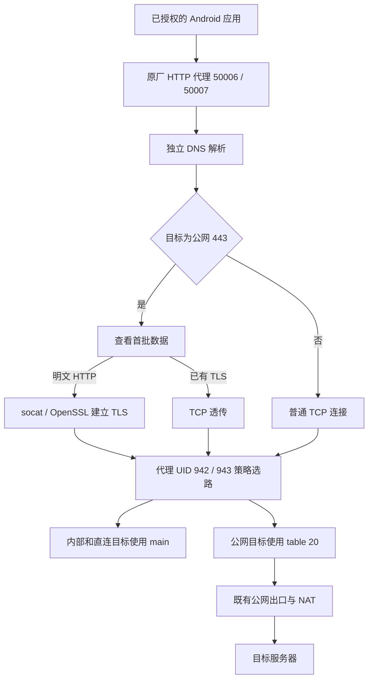
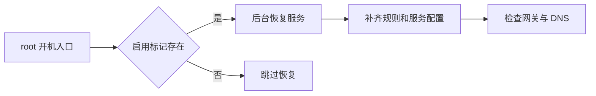
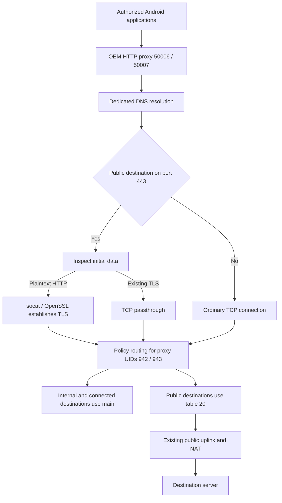
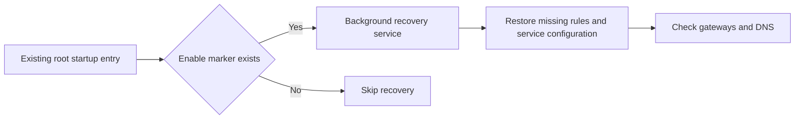

[中文](#中文) | [English](#english)

# 车机 HTTP 网关补丁 / In-Vehicle HTTP Gateway Patch

## 中文

**适配范围：大众 ID 系列车型的 2995 固件。其他车型或固件版本未验证。**

基于原厂 HTTP 网关，解除转发路径对域名和服务名目录的依赖，补齐公网路由、DNS 与 HTTPS 处理。

### 功能

- 支持 B2C `50007`、B2B `50006` 两个代理入口，多应用共用。
- 新增目标无需补充网关域名或服务名名单。
- 仅为代理服务配置公网选路，保留内部网络和直连路由。
- 使用独立 DNS，兼容明文 HTTP 补 TLS 与已有 TLS 透传。
- 支持开机恢复和运行回滚。

### 原理



### 适用范围

已适配环境为大众 ID 系列车型的 2995 固件，需要 root 权限，以及系统提供的 systemd、socat、OpenSSL 和 CA 证书。

Android 应用仍需联网授权和正确的代理配置。UID `942/943` 属于 Linux 代理服务，不是某个 Android 应用。自行直连、UDP/QUIC 等绕过代理的流量不在处理范围内。

下表为目标服务器端口，代理入口仍是 `50006/50007`。

| 目标请求 | 支持情况 |
| --- | --- |
| HTTP 80 | 允许普通 HTTP 访问 |
| HTTP 8000、8080 等 | 默认规则允许，未逐端口实测 |
| HTTPS 443 | 已验证明文补 TLS 和 CONNECT/TLS |
| HTTPS 8443、9443 等 | 需要扩展 CONNECT 配置及适用的 TLS 处理 |

普通 HTTP 默认允许 `80–100`、`443`、`1024–65535`。CONNECT 有独立端口限制；自动补 TLS 默认只处理 `443`。

### 仅分发真正的 patch（原厂文件 → 当前 v5）

仓库不再保存完整的 `http-gateway` / `http-gateway-b2b`。差量直接以 **2995 原厂文件** 为输入，不依赖 v2/v3 或其他旧补丁；每份程序只分发实际变化的 **57 字节**（12 个连续范围），输出与原仓库 v5 的 SHA-256 完全一致。`targets.tsv` 固定原厂/输出哈希，`manifest.json` 列出偏移和长度。现有 TLS 配套库 `libgateway_tls.so` 原样保留，不将其当作车机主程序差量。

部署默认读取本机 `/lge/app_ro/http-gateway` 的原厂文件，先复制到可写候选目录再应用差量。另存的原厂目录可通过 `GATEWAY_SOURCE=/path/to/factory sh manage.sh preflight` 指定，apply 时使用同一变量。不要使用旧补丁的修改文件作为输入。未知输入会在改写之前退出。服务、TLS、DNS、开机恢复及 `manage.sh` 命令接口保留。

部署前可独立验证文件（不会启动服务或写入原厂目录）：

```sh
sh patch_binary.sh check /path/to/factory/http-gateway
cp -p /path/to/factory/http-gateway /path/to/writable/http-gateway
sh patch_binary.sh apply /path/to/writable/http-gateway /path/to/local-backups
sh patch_binary.sh rollback /path/to/writable/http-gateway /path/to/local-backups
```

安装器使用本机原厂文件制作候选，候选写入前后校验完整 SHA-256，文件备份仅在本机生成。`manage.sh rollback` 保留原有语义：撤销本次服务覆盖/选路并恢复此前服务路径；独立文件 helper 的 rollback 恢复候选文件原始字节和元数据。

维护与打包：

```sh
python scripts/audit_distribution.py
python -m unittest discover -s tests -v
python scripts/package.py --output /local/releases/http-gateway-factory-patch.zip
# 仅维护者重新生成差量时使用，所有完整输入/输出均放在仓库外：
python scripts/generate_delta.py --factory-dir /local/factory \
  --modified-dir /local/verified-v5 --output /local/delta-staging
```

CI 使用动态合成数据测试，不上传车机文件。打包采用显式白名单，重新打开 ZIP 校验成员与哈希。完整原文件、完整修改文件、完整反汇编和本机备份均禁止进入新包。差量重生成后需更新对应校验清单。历史提交及旧附件的处理见 [MIGRATION.md](MIGRATION.md)；删除当前树文件不代表历史已清除。

### 部署

在软件包目录执行：

```sh
sh manage.sh preflight
sh manage.sh apply
sh manage.sh status
```

已安装设备无需重复 `apply`。请保留安装目录和部署状态目录。

### 开机恢复



先将安装目录中的 `boot-restore.sh launch` 接入现有 root 开机入口，再在安装目录启用：

```sh
touch persist.enabled
sh boot-restore.sh launch
sh boot-restore.sh status
```

根分区只读时，可通过可写分区的启动钩子后台调用。仅创建标记不会建立开机入口。恢复过程不重复添加相同规则，也不重启已正确运行的服务。

### 回滚

在安装目录执行：

```sh
rm -f persist.enabled
sh manage.sh rollback
```

回滚关闭开机恢复，撤销本补丁拥有的规则和服务覆盖，恢复原启动路径。检测到外部修改时会保留现场并报错。

### 验证状态

两个代理端口的 8 项 HTTP/HTTPS 测试均返回 HTTP 200，酷我网页和高德搜索已确认正常。开机恢复逻辑已通过检查，现有记录尚不包含真实整机重启验收结果。

---

## English

**Target platform: Volkswagen ID. series vehicles running firmware 2995. Other vehicle models or firmware releases have not been verified.**

Extends the OEM HTTP gateway with public-network routing, dedicated DNS and HTTPS handling, removing the forwarding dependency on the original domain and service-name catalogs.

### Features

- Shared proxy endpoints: B2C `50007` and B2B `50006`.
- New destinations do not require gateway domain or service-name entries.
- Routing is scoped to the proxy services, preserving internal and directly connected routes.
- Dedicated DNS, TLS wrapping for plaintext HTTP, and passthrough for existing TLS.
- Startup recovery and runtime rollback.

### Architecture



### Scope

The adapted environment is Volkswagen ID. series vehicles running firmware 2995. Requires root access and the system-provided systemd, socat, OpenSSL and CA certificates.

Android applications still need network authorization and correct proxy configuration. UIDs `942/943` identify the Linux proxy services, not individual Android applications. Direct connections, UDP/QUIC and other traffic bypassing the proxies are outside the scope.

The table below lists destination ports. Proxy listening ports remain `50006/50007`.

| Destination request | Support |
| --- | --- |
| HTTP on port 80 | Ordinary HTTP is allowed |
| HTTP on ports such as 8000 or 8080 | Allowed by default rules; not individually tested |
| HTTPS on port 443 | Plaintext-to-TLS and CONNECT/TLS verified |
| HTTPS on ports such as 8443 or 9443 | Requires changes to CONNECT rules and applicable TLS handling |

Ordinary HTTP allows `80–100`, `443` and `1024–65535` by default. CONNECT has a separate port policy; automatic TLS wrapping handles only `443` by default.

### True patch distribution (factory files → current v5)

The complete `http-gateway` and `http-gateway-b2b` executables are no longer shipped. The patch takes **2995 factory files directly**, not v2/v3 outputs. Each executable needs only **57 changed bytes in 12 contiguous ranges**, reproducing the existing v5 SHA-256 exactly. The existing `libgateway_tls.so` TLS helper remains byte-identical.

`manage.sh` reads factory inputs from `/lge/app_ro/http-gateway` by default; use the same `GATEWAY_SOURCE=/path/to/factory` for preflight and apply to override it. All changes are made to writable copies. Unknown inputs are rejected before modification. Existing TLS, DNS, routing, boot recovery and management commands are retained. File-only apply/rollback uses `patch_binary.sh`; deployment rollback keeps its existing service-path restoration behavior.

Use `python scripts/audit_distribution.py`, `python -m unittest discover -s tests -v`, and `python scripts/package.py --output /local/releases/http-gateway-factory-patch.zip` to audit/test/package. Tests generate synthetic data instead of storing firmware fixtures. The allowlisted ZIP is reopened and checked. Full firmware programs, disassemblies and local backups are excluded. See [MIGRATION.md](MIGRATION.md) for history and old-attachment cleanup; deleting files at HEAD does not erase old commits.

### Deployment

Run from the package directory:

```sh
sh manage.sh preflight
sh manage.sh apply
sh manage.sh status
```

Do not repeat `apply` on an installed system. Retain the installation and deployment-state directories.

### Startup recovery



First connect `boot-restore.sh launch` from the installation directory to an existing root startup entry. Then enable it from the installation directory:

```sh
touch persist.enabled
sh boot-restore.sh launch
sh boot-restore.sh status
```

For a read-only root filesystem, use a startup hook on writable storage to launch recovery in the background. Creating the marker alone does not install a startup entry. Recovery avoids duplicate rules and does not restart correctly running services.

### Rollback

Run from the installation directory:

```sh
rm -f persist.enabled
sh manage.sh rollback
```

Rollback disables startup recovery, removes rules and service overrides owned by the patch, and restores the previous startup path. Externally modified state is preserved and reported.

### Validation

All eight HTTP/HTTPS tests across both proxy endpoints returned HTTP 200. Kuwo web access and Amap search were confirmed working. Recovery logic passed its checks; a full-device reboot acceptance result has not yet been recorded.
